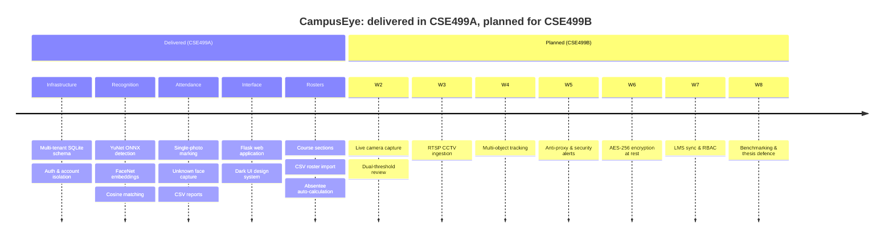

# CampusEye: Sophisticated Campus Monitoring System

**Senior Design Project (CSE 499A / CSE 499.15 — Fall 2026)**  
**Department of Electrical & Computer Engineering, North South University**

---

## 👥 Authors & Lead Developers
* **Rafiqul Islam** (ID: 2122414642) — `rafiqul.islam12@northsouth.edu`
* **Safayat Ibrahim** (ID: 2131174642) — `safayat.ibrahim@northsouth.edu`

**Supervisor:** Mohammad Shifat-E-Rabbi

---

## 📌 Project Vision & Overview
**CampusEye** replaces the classroom roll call and the RFID card with a single photograph. A teacher enrols each student once, then photographs the room; every registered face is detected, matched and written to the register, and everyone on the course roster who was not recognised is marked absent.

The longer-term goal is to grow that pipeline into continuous campus monitoring across CCTV feeds. **CSE499A delivered the single-photograph system described below. The CCTV, tracking, anti-proxy and encryption work is planned for CSE499B and is not yet implemented.**

### ✅ Built and working today
* 📸 **Single-photo classroom attendance:** one group photograph marks the whole class, with every detected face boxed and labelled in the returned image.
* 🧠 **Deep learning recognition engine:** **YuNet ONNX CNN** for multi-face detection (Haar cascade retained as a compatibility fallback) and **DeepFace / FaceNet** for 128-dimensional embeddings, matched by cosine distance against a tunable threshold.
* 👤 **Multi-sample biometric enrolment:** 10 photographs per student, averaged into a single template so no one image defines an identity.
* 🏫 **Course sections and rosters:** relational `classes` and `class_enrollments` tables, CSV roster import, and attendance scoped per section.
* 🧮 **Automatic absentee resolution:** absentees computed as *roster − recognised*, so one photograph produces a complete register rather than a list of attendees.
* 🔑 **Multi-tenant isolation:** every student, register and embedding cache is scoped to the owning account, with Werkzeug-hashed passwords. Isolation is asserted by automated tests.
* 📊 **Reports and export:** per-date register with section filtering, sortable columns, and CSV export for institutional records.
* 🖼️ **Unknown face capture:** unrecognised faces are saved to disk for later review.
* 🧪 **25 automated tests** covering authentication, account isolation, roster logic and the schema migration.

### 🛠️ Planned for CSE499B — not yet implemented
* 🎥 Live browser camera capture (WebRTC) and continuous RTSP ingestion from IP cameras
* 🎯 Dual-threshold confidence bands with a teacher review queue, and an unknown-faces review gallery
* 🔁 Multi-object tracking across frames (ByteTrack / DeepSORT)
* 🛡️ Anti-proxy and liveness verification, impossible-travel detection, security alerts
* 🔒 AES-256 encryption of biometric templates at rest and a retention policy for captured faces
* 🔗 LMS synchronisation API and role-based access control
* 📈 Large-scale accuracy benchmarking on a labelled classroom dataset

---

## 🗺️ Roadmap



### Delivered in CSE499A

| Area | Deliverables | Status |
| :--- | :--- | :--- |
| **Infrastructure & auth** | Modular layout, SQLite schema with `owner_id` scoping, Werkzeug password hashing | ✅ Complete |
| **Recognition engine** | YuNet ONNX detection, FaceNet 128-d embeddings, cosine matching, 10-sample enrolment | ✅ Complete |
| **Single-photo attendance** | Batch classroom processing, duplicate-safe marking, CSV export, unknown face capture | ✅ Complete |
| **Web interface** | Flask application, JSON API, accessibility-checked dark UI, responsive 375–1440 px | ✅ Complete |
| **Courses & rosters** | `classes` / `class_enrollments` tables, CSV import, per-section attendance, absentee resolution | ✅ Complete |

### Planned for CSE499B

| Version | Milestone | Key deliverables |
| :--- | :--- | :--- |
| **v2.0** | **Week 2: Live camera & dual threshold** | Browser capture via `getUserMedia`, confidence bands (≤ 0.40 present, 0.40–0.60 review, > 0.60 unknown), one-click Present/Absent/Excused correction, unknown-faces gallery |
| **v3.0** | **Week 3: Continuous CCTV ingestion** | Threaded RTSP/HTTP stream reading, adaptive frame dropping, annotated MJPEG endpoint |
| **v4.0** | **Week 4: Multi-object tracking** | ByteTrack or DeepSORT over YuNet detections, persistent track IDs, dwell-time logging |
| **v5.0** | **Week 5: Anti-proxy & alerts** | Impossible-travel detection, passive anti-spoofing against printed and screen attacks, real-time alerts |
| **v6.0** | **Week 6: Encryption & privacy** | AES-256-GCM encryption of embeddings at rest, 30-day retention cleanup for captured unknown faces |
| **v7.0** | **Week 7: LMS integration & analytics** | Attendance trend charts, at-risk flagging below 75%, LMS export endpoints, role-based access control |
| **v8.0** | **Week 8: Benchmarking & defence** | 40–100 face classroom benchmark, accuracy and false-positive measurement, final thesis defence package |

---

## 📂 Final Project Submission (CSE499A)

All final project materials are available in the following Google Drive folder:

🔗 **[Final Submission – Video Presentation, Presentation Slides, Demo Video & Final Report](https://drive.google.com/drive/folders/1HRrFamy6rCWBnSMfCt2cmwiTa1I-iqh2?usp=drive_link)**

The folder contains:

- 🎥 Final Video Presentation
- 🖥️ Final Presentation Slides
- 💻 Project Demo Video
- 📄 Final Project Report

The final report (`CampusEye_CSE499A_Final_Report.docx`) and presentation (`Final Presentation slide.pptx`) are also committed to this repository.

---

## 🚀 Quick Start Guide

### Prerequisites
* Python 3.10+
* Virtual environment (`.venv`) inside `attendance_system/` with dependencies installed

### Running the Web Application
```bash
# Navigate to attendance_system directory
cd attendance_system

# Launch the Flask server using the project virtualenv
.venv\Scripts\python main.py
```

Open your browser and navigate to:
👉 **[http://127.0.0.1:5000](http://127.0.0.1:5000)**

Create an account on first run, then enrol a student, create a course section and import its roster before taking attendance.

---

## 🧪 Running Automated Tests
```bash
cd attendance_system
.venv\Scripts\python -m pytest -v tests/
```

25 tests cover authentication, per-account isolation, course and roster management, absentee resolution and the in-place schema migration.

> **Note:** `tests/test_week3.py` and `tests/test_logic_non_interactive.py` currently write to the live `database/attendance.db` rather than a temporary database. Until that is fixed, running the suite modifies real data.

---

## 🔐 Privacy & Data Handling

Biometric data stays out of version control: `.gitignore` excludes the database, enrolled face images, captured unknown faces and the session secret key. Only `.gitkeep` placeholders are tracked.

Face templates are currently stored as pickled NumPy arrays **without encryption**, and captured unknown faces have **no retention limit**. Both are addressed in the CSE499B plan (Week 6) and neither is suitable for deployment beyond a controlled prototype.

---

## 📂 Project Architecture
```
attendance_system/
├── config.py                 # Thresholds, paths & DeepFace model configuration
├── main.py                   # Application entry point
├── requirements.txt          # Python dependencies
├── database/
│   ├── db_manager.py         # Schema, migrations, auth & roster CRUD, data isolation
│   └── attendance.db         # Auto-generated database (gitignored)
├── models/
│   ├── yunet.onnx            # Pre-trained CNN face detector
│   └── cascades/             # Haar Cascade compatibility fallback
├── utils/
│   ├── detection.py          # YuNet & Haar multi-face detection
│   ├── recognition.py        # DeepFace embedding extraction & cosine matching
│   ├── registration.py       # Multi-sample student enrolment
│   ├── attendance.py         # Attendance pipeline, absentee resolution, reports
│   ├── auth.py               # Account creation & password verification
│   └── image_processing.py   # CLAHE & resize helpers (currently unused)
├── web/
│   ├── app.py                # Flask routes & JSON API
│   ├── auth.py               # Login, sign-up, logout routes
│   ├── static/
│   │   ├── css/style.css     # Dark UI design system (layered tokens)
│   │   └── js/               # common, dashboard, attendance, register,
│   │                         # reports, courses, course_detail, students
│   └── templates/            # Jinja2 templates: base, auth, index, register,
│                             # attendance, reports, courses, course_detail,
│                             # students, not_found
└── tests/
    ├── test_auth.py                 # Account isolation & authentication
    ├── test_logic_non_interactive.py # Registration & pipeline logic
    ├── test_week1_roster.py         # Courses, rosters & absentee resolution
    ├── test_week3.py                # Attendance marking
    └── test_week5.py                # Documentation presence
```
